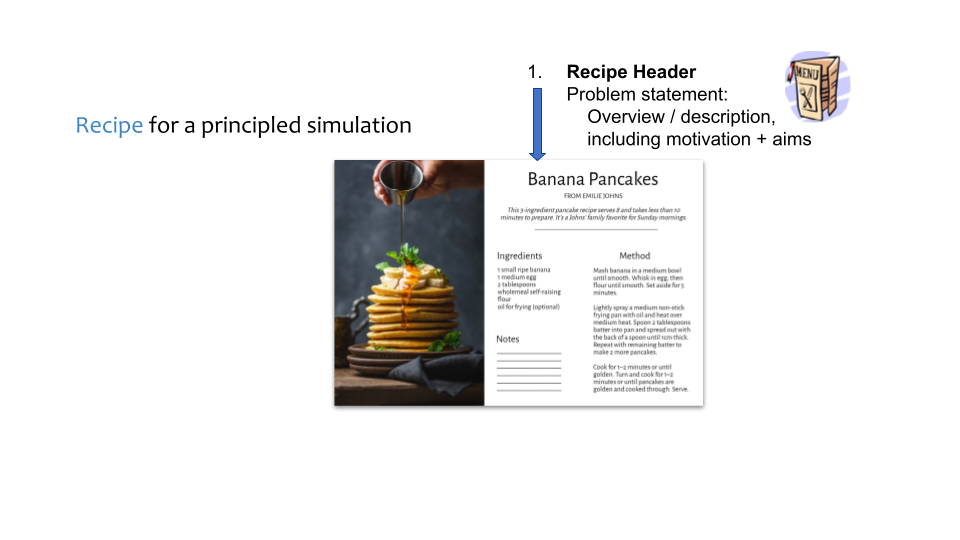
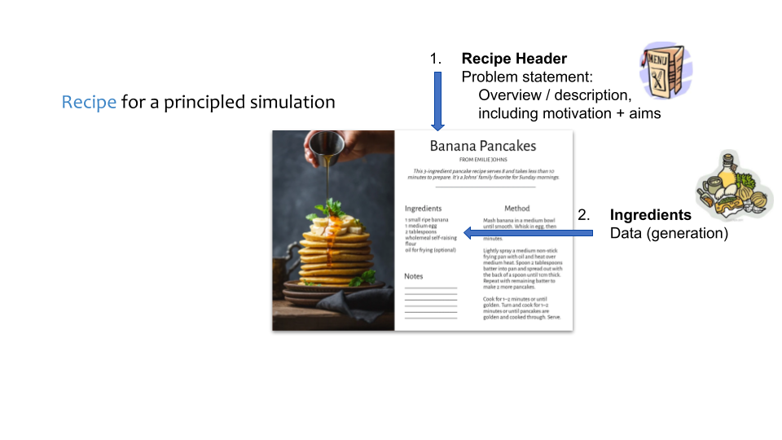
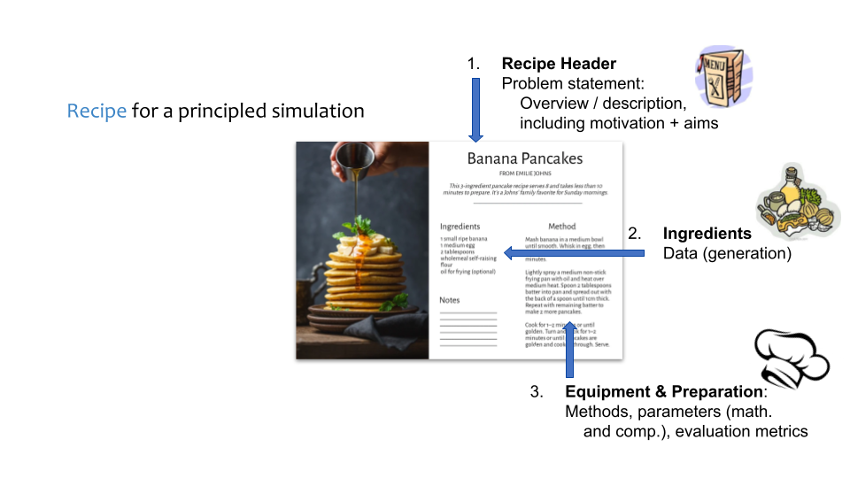
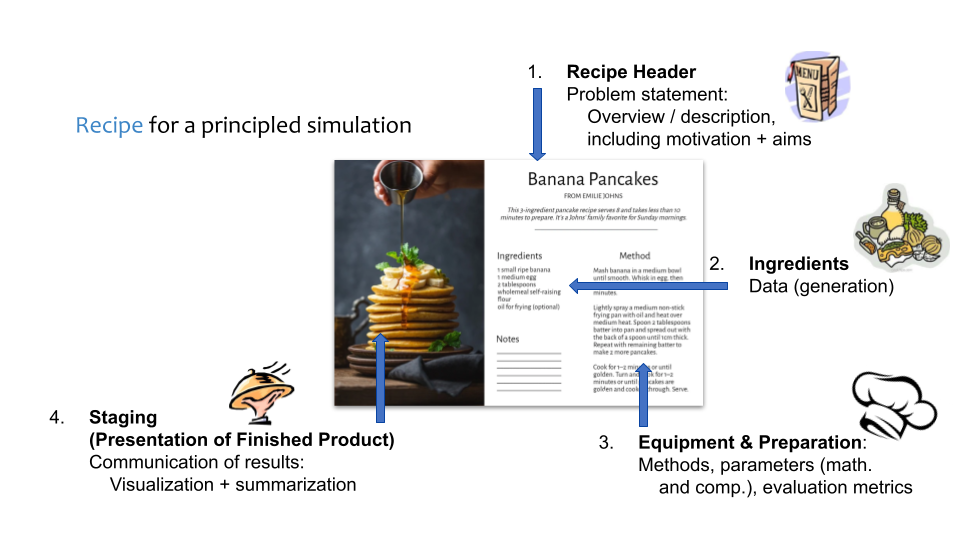
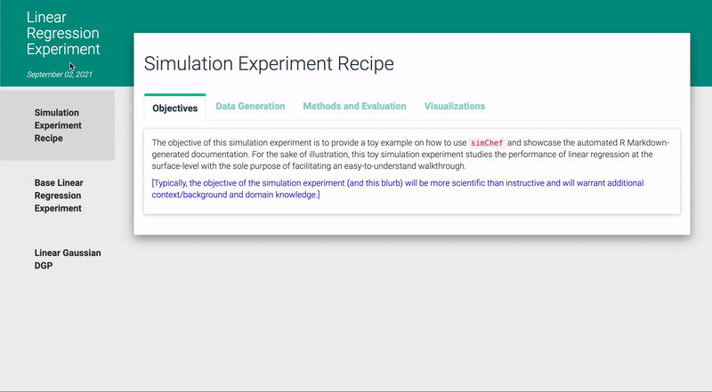

## Today's recipe {.hide-logo}

### 1. Overview {.recipe-overview}

- Why simulations?
- What makes a "high-quality" simulation?

### 2. Using `simChef` to cook up simulations with MERITS {.recipe-overview}

- Overview of `simChef`
- Case study: Interaction discovery with iRF


## Why simulations? {.hide-logo}

. . .

Simulations are a **powerful and ubiquitous** tool in the modern scientific process.

<div style="height: 0.2em;"></div>

::: {.fragment .fade-in .incremental}
They can be used to quickly

- **screen hypotheses** and identify those worth pursuing
- **model natural systems** under specific or rare conditions
- **stress-test** emerging theories and methods
:::

. . .

Importantly, simulations offer **full control** over experimental conditions.


## What makes a "high-quality" simulation? {.hide-logo .merits-slide}

. . .

Building upon PCS, a "high-quality" simulation should be one with **MERITS**

::: {.merits-list}
::: {.fragment .fade-in .merits-row}
<div class="merits-letter"><span>**M**</span></div>
<div class="merits-definition">**Modular**: written in self-contained and logically partitioned segments of code</div>
:::

::: {.fragment .fade-in .merits-row}
<div class="merits-letter"><span>**E**</span></div>
<div class="merits-definition">**Efficient**: streamlined computationally and conceptually</div>
:::

::: {.fragment .fade-in .merits-row}
<div class="merits-letter"><span>**R**</span></div>
<div class="merits-definition">**Realistic**: faithful to the natural world or realm of application, to the best extent allowed by established theory and/or available real-world data</div>
:::

::: {.fragment .fade-in .merits-row}
<div class="merits-letter"><span>**I**</span></div>
<div class="merits-definition">**Intuitive**: sensible to the intended audience and a broad range of potential consumers, across all parts of the pipeline: simulation architecture, documentation, code, and analysis of results</div>
:::

::: {.fragment .fade-in .merits-row}
<div class="merits-letter"><span>**T**</span></div>
<div class="merits-definition">**Transparent**: documented thoroughly and candidly</div>
:::

::: {.fragment .fade-in .merits-row}
<div class="merits-letter"><span>**S**</span></div>
<div class="merits-definition">**Stable**: reproducible, replicable, and (potentially) generalizable beyond the scope of the simulation</div>
:::
:::

## How to create a simulation with MERITS? {.hide-logo}

Similar to cooking, crafting a simulation with MERITS requires careful **planning**!

. . . 

::: {.r-stack}

{.recipe1}

{.recipe2 .fragment .fade-in}

{.recipe3 .fragment .fade-in}

{.recipe4 .fragment .fade-in}

:::


## {.hide-logo .papers-slide}

::: {.papers-stage}
::: {.paper-entry}
<div class="paper-title"><a href="https://www.tandfonline.com/doi/pdf/10.1080/10618600.2025.2561905">Designing a Data Science Simulation with MERITS: A Primer</a></div>

<div class="paper-meta">2026 · <em>Journal of Computational and Graphical Statistics</em></div>

::: {.paper-authors .six-authors}
::: {.paper-author}
{fig-alt="Corrine Elliott"}

Corrine Elliott
:::
::: {.paper-author}
{fig-alt="James Duncan"}

James Duncan
:::
::: {.paper-author}
{fig-alt="Tiffany Tang"}

Tiffany Tang
:::
::: {.paper-author}
{fig-alt="Merle Behr"}

Merle Behr
:::
::: {.paper-author}
{fig-alt="Karl Kumbier"}

Karl Kumbier
:::
::: {.paper-author}
{fig-alt="Bin Yu"}

Bin Yu
:::
:::
:::

::: {.paper-entry .fragment .fade-in}
<div class="paper-title"><a href="https://joss.theoj.org/papers/10.21105/joss.06156.pdf">simChef: High-quality data science simulations in R</a></div>

<div class="paper-meta">2024 · <em>Journal of Open Source Software</em></div>

::: {.paper-authors .five-authors}
::: {.paper-author}
{fig-alt="James Duncan"}

James Duncan
:::
::: {.paper-author}
{fig-alt="Tiffany Tang"}

Tiffany Tang
:::
::: {.paper-author}
{fig-alt="Corrine Elliott"}

Corrine Elliott
:::
::: {.paper-author}
{fig-alt="Philippe Boileau"}

Philippe Boileau
:::
::: {.paper-author}
{fig-alt="Bin Yu"}

Bin Yu
:::
:::
:::
:::


## Overview of `simChef` {.simchef-vision-slide}

`simChef` is a versatile R package to create high-quality simulations with **MERITS**, with PCS as the guiding framework.

<div style="height: 1em;"></div>

. . .

### The `simChef` Vision

::: {.fade-in .incremental .vision-principles}
<!-- - Versatile **R framework** to support simulation studies satisfying these MERITS -->
- Allow data scientists to focus on substantive questions with **fewer technical distractions**
- **Lower** the **activation barrier** to running high-quality simulation studies
- Provide comprehensive simulation **documentation** and archive of simulation artifacts for **transparency and reproducibility**
:::


## `simChef` Highlights

- A **tidy grammar** for simulation studies

```{r}
#| eval: false
#| echo: true
#| code-line-numbers: "|1-2|1-3|1-4|1-5|1-6|1-7|1-10|1-13|1-14"

# create experiment recipe
experiment <- create_experiment(name = "My Experiment") |>
  add_dgp(my_dgp) |>
  add_method(my_method) |>
  add_evaluator(my_evaluator) |>
  add_visualizer(my_visualizer) |>
  add_vary_across(.dgp = my_dgp, n = c(10, 100, 1000))

# run experiment
my_results <- run_experiment(experiment, n_reps = 25, save = TRUE)

# document and visualize experiment results
init_docs(experiment)
render_docs(experiment)
```

## `simChef` Highlights

- A **tidy grammar** for simulation studies
- Automated **documentation** and **visualization** of results
  ```{r}
  #| eval: false
  #| echo: true

  render_docs(experiment)
  ```  

. . .

  {.simchef-gif}


## {.no-padding .hide-logo}

An example simulation project: [github.com/PhilBoileau/simChef-case-study](https://github.com/PhilBoileau/simChef-case-study)

<iframe class="philboileau-embed" src="ex/empirical-fdr-comparison.html" title="Philippe Boileau simChef case study"></iframe>


## `simChef` Highlights

- A **tidy grammar** for simulation studies
- Automated **documentation** and **visualization** of results

::: {.fade-in .incremental .fade-in style="margin-top: -0.65em;"}
- **Caching** of results
- Ease of **parallelization**
- **Debugging** tools
- Built in **library** of evaluation and plotting functions
:::

## Creating your own `simChef` simulation {.component-slide}

```{r}
#| eval: false
#| echo: true
#| code-line-numbers: "3-6"

# create experiment recipe
experiment <- create_experiment(name = "My Experiment") |>
  add_dgp(my_dgp) |>
  add_method(my_method) |>
  add_evaluator(my_evaluator) |>
  add_visualizer(my_visualizer) |>
  add_vary_across(.dgp = my_dgp, n = c(10, 100, 1000))

# run experiment
my_results <- run_experiment(experiment, n_reps = 25, save = TRUE)

# document and visualize experiment results
init_docs(experiment)
render_docs(experiment)
```

<div class="simchef-components fragment fade-in">
<div class="simchef-component">
<div class="simchef-component-title">DGP</div>
<p>the data-generating process from which to <b>generate</b> data</p>
</div>
<div class="simchef-component">
<div class="simchef-component-title">Method</div>
<p>the methods (or models) to <b>fit</b> in the simulation experiment</p>
</div>
<div class="simchef-component">
<div class="simchef-component-title">Evaluator</div>
<p>the evaluation metrics used to <b>evaluate</b> the methods' performance</p>
</div>
<div class="simchef-component">
<div class="simchef-component-title">Visualizer</div>
<p>the visualization functions used to <b>visualize</b> the results (e.g., tables, plots, written text)</p>
</div>
</div>

<div class="simchef-component-stage">
<div class="simchef-constructor-row fragment fade-in-then-out">
<div class="simchef-constructor" markdown="1">

```{r}
#| eval: false
#| echo: true
#| code-line-numbers: false

dgp <- create_dgp(
  .dgp_fun = dgp_fun, 
  .name = "DGP Name",
  # named arguments to pass to .dgp_fun
  ...
)
```

</div>
<div class="simchef-constructor" markdown="1">

```{r}
#| eval: false
#| echo: true
#| code-line-numbers: false

method <- create_method(
  .method_fun = method_fun, 
  .name = "Method Name",
  # named arguments to pass to .method_fun
  ...
)
```

</div>
<div class="simchef-constructor" markdown="1">

```{r}
#| eval: false
#| echo: true
#| code-line-numbers: false

evaluator <- create_evaluator(
  .eval_fun = eval_fun, 
  .name = "Evaluator Name",
  # named arguments to pass to .eval_fun
  ...
)
```

</div>
<div class="simchef-constructor" markdown="1">

```{r}
#| eval: false
#| echo: true
#| code-line-numbers: false

visualizer <- create_visualizer(
  .viz_fun = viz_fun, 
  .name = "Visualizer Name",
  # named arguments to pass to .viz_fun
  ...
)
```

</div>
</div>

<div class="simchef-component-takeaways fragment fade-in">
<ul>
<li>Can have multiple DGPs, methods, evaluators, and visualizers</li>
<li>Can also add multiple DGP/methods parameters to <strong>vary across</strong> (e.g., sample size, signal-to-noise ratio, method hyperparameters, etc.)</li>
</ul>
</div>
</div>


## Case Study: Interaction Discovery with iRF {.hide-logo .irf-intro-slide}

**Iterative Random Forests (iRF)**: computationally efficient tree-based method for detecting ***stable, high-order interactions*** in high-dimensional data <span style="font-size: 0.8em;"><a href="https://doi.org/10.1073/pnas.1711236115">(Basu et al. 2018)</a></span>

<div style="height: 0.05em;"></div>

. . .

<u>Applications</u>:

- Transcription factor interactions in Drosophila embryos<sup class="citation-marker"><a href="https://doi.org/10.1073/pnas.1711236115">[1]</a></sup>
- Chromatin interactions associated with alternative splicing<sup class="citation-marker"><a href="https://doi.org/10.1073/pnas.1711236115">[1]</a></sup>
- Genetic interactions (epistasis) associated with red hair, multiple sclerosis,<sup class="citation-marker"><a href="https://doi.org/10.1371/journal.pone.0298906">[2]</a></sup> and cardiac hypertrophy<sup class="citation-marker"><a href="https://doi.org/10.1038/s44161-025-00656-8">[3]</a></sup>
- Chemical exposure interactions associated with child neurodevelopment<sup class="citation-marker"><a href="https://doi.org/10.1021/acs.est.3c00848">[4]</a></sup>

<div class="case-study-citations">
<div><a href="https://doi.org/10.1073/pnas.1711236115">[1] Basu et al. (2018). “Iterative random forests to discover predictive and stable high-order interactions.” <i>PNAS</i>.</a></div>
<div><a href="https://doi.org/10.1371/journal.pone.0298906">[2] Behr et al. (2024). “Learning epistatic polygenic phenotypes with Boolean interactions.” <i>PLOS ONE</i>.</a></div>
<div><a href="https://doi.org/10.1038/s44161-025-00656-8">[3] Wang et al. (2025). “Epistasis regulates genetic control of cardiac hypertrophy.” <i>Nature Cardiovascular Research</i>.</a></div>
<div><a href="https://doi.org/10.1021/acs.est.3c00848">[4] Midya et al. (2023). “Machine learning assisted discovery of interactions between pesticides, phthalates, phenols, and trace elements in child neurodevelopment.” <i>Environmental Science &amp; Technology</i>.</a></div>
</div>

::: {.fragment .fade-in .case-study-script-link}
See [case-studies/interaction_discovery.R](https://github.com/tiffanymtang/simChef-culinary-school/blob/main/case-studies/interaction_discovery.R) for reproducible simulation script
:::


## Case Study: The `simChef` Recipe {.irf-components-slide}

<div class="irf-component-grid">
<div class="irf-component-card fragment fade-in" data-fragment-index="1">
<div class="irf-component-number">1</div>
<div class="irf-component-name">DGP</div>
<div class="irf-component-function">generate_xy_data()</div>
<ul>
<li>Ideally, should generate data that is representative of the intended real-world scenario</li>
</ul>
<div class="irf-component-output"><b>Returns:</b> train/test ($X, y$) + true interactions</div>
</div>
<div class="irf-component-card fragment fade-in" data-fragment-index="2">
<div class="irf-component-number">2</div>
<div class="irf-component-name">Method</div>
<div class="irf-component-function">fit_irf()</div>
<ul>
<li>Fit iRF to the simulated data</li>
<li>(+ other comparison methods)</li>
</ul>
<div class="irf-component-output"><b>Returns:</b> iRF fit (predictions + interactions)</div>
</div>
<div class="irf-component-card fragment fade-in" data-fragment-index="3">
<div class="irf-component-number">3</div>
<div class="irf-component-name">Evaluators</div>
<div class="irf-component-function">eval_predictions(), eval_interactions(), eval_stability()</div>
<ul>
<li>Evaluate prediction performance</li>
<li>Evaluate interaction recovery (TPs vs. FPs)</li>
<li>Evaluate stability of the learned interactions</li>
</ul>
<div class="irf-component-output"><b>Returns:</b> table of evaluation metrics</div>
</div>
<div class="irf-component-card fragment fade-in" data-fragment-index="4">
<div class="irf-component-number">4</div>
<div class="irf-component-name">Visualizers</div>
<div class="irf-component-function">plot_predictions(), plot_interactions(), plot_stability()</div>
<div style="height: 0.5em;"></div>
<svg class="irf-mini-plot" viewBox="0 0 240 148" role="img" aria-label="Three example blue bar plots for prediction, interaction recovery, and stability results">
  <g class="mini-bar-panel">
    <text class="mini-panel-title" x="57" y="10">Prediction</text>
    <line class="mini-axis" x1="12" y1="57" x2="103" y2="57" />
    <line class="mini-axis" x1="12" y1="17" x2="12" y2="57" />
    <rect class="mini-bar" x="24" y="38" width="14" height="19" rx="1" />
    <rect class="mini-bar" x="49" y="27" width="14" height="30" rx="1" />
    <rect class="mini-bar" x="74" y="19" width="14" height="38" rx="1" />
  </g>
  <g class="mini-bar-panel">
    <text class="mini-panel-title" x="181" y="10">Interaction recovery</text>
    <line class="mini-axis" x1="137" y1="57" x2="228" y2="57" />
    <line class="mini-axis" x1="137" y1="17" x2="137" y2="57" />
    <rect class="mini-bar" x="149" y="44" width="14" height="13" rx="1" />
    <rect class="mini-bar" x="174" y="32" width="14" height="25" rx="1" />
    <rect class="mini-bar" x="199" y="21" width="14" height="36" rx="1" />
  </g>
  <g class="mini-bar-panel">
    <text class="mini-panel-title" x="120" y="81">Stability</text>
    <line class="mini-axis" x1="74" y1="137" x2="165" y2="137" />
    <line class="mini-axis" x1="74" y1="91" x2="74" y2="137" />
    <rect class="mini-bar" x="86" y="119" width="14" height="18" rx="1" />
    <rect class="mini-bar" x="111" y="104" width="14" height="33" rx="1" />
    <rect class="mini-bar" x="136" y="95" width="14" height="42" rx="1" />
  </g>
</svg>
<div class="irf-component-output"><b>Returns:</b> visualizations of results</div>
</div>
</div>

<div class="irf-design-controls fragment fade-in" data-fragment-index="5">
<div class="irf-design-control-stack">
<div class="irf-design-control"><b>Vary:</b> $n \in \{400,1200,2000\}$</div>
<!-- <div class="irf-design-control"><b>Vary:</b> noise type $\in \{\text{RF},\text{swap}\}$</div> -->
</div>
<div class="irf-design-control-stack">
<div class="irf-design-control fragment irf-gray-out" data-fragment-index="6"><b>Vary:</b> num. of iterations $K=1,\ldots,5$</div>
</div>
</div>

<div class="irf-dgp-summary">
<div class="irf-dgp-summary-rule fragment fade-in" data-fragment-index="7"></div>
<div class="irf-dgp-summary-title fragment fade-in" data-fragment-index="7">How to construct a realistic and meaningful DGP?</div>
<div class="irf-dgp-equation fragment fade-in" data-fragment-index="8">$y = f(X) + \varepsilon$</div>
<div class="irf-dgp-summary-grid">
<div class="irf-dgp-summary-item fragment fade-in" data-fragment-index="9">
<div class="irf-dgp-summary-label">Choice of $X$</div>
<ul>
<li>Use (bootstrapped or subsampled) <b>real data for $X$</b> to preserve realistic feature distributions and correlation structures</li>
</ul>
<div></div>
</div>
<div class="irf-dgp-summary-item fragment fade-in" data-fragment-index="10">
<div class="irf-dgp-summary-label">Choice of $f$</div>
<ul>
<li>Use <b>domain knowledge</b> or existing models to inform choice of $f$</li>
<li><b>Fit model using real data to estimate parameters</b> and then simulate using these estimated parameters</li>
</ul>
</div>
<div class="irf-dgp-summary-item fragment fade-in" data-fragment-index="11">
<div class="irf-dgp-summary-label">Choice of $\varepsilon$</div>
<ul>
<li><b>Fit model using real data and bootstrap the residuals</b> to create realistic noise</li>
</ul>
</div>
</div>
<div class="irf-dgp-example-grid">
<div class="irf-dgp-example-item fragment fade-in" data-fragment-index="9"><b>E.g.,</b> Drosophila enhancer data</div>
<div class="irf-dgp-example-item fragment fade-in" data-fragment-index="10"><b>E.g.,</b> Boolean interactions (LSS model) to mimic on/off thresholding behavior of genes</div>
<div class="irf-dgp-example-item fragment fade-in" data-fragment-index="11"><b>E.g.,</b> RF noise</div>
</div>
</div>


## Case Study: Creating the DGP {.component-code-slide}

<div class="component-progress"><span class="active">DGP</span><span>Method</span><span>Evaluator</span><span>Visualizer</span></div>

::: {.component-code-grid}
::: {.component-code-step}
<div class="component-code-label"><span>1</span> Define <code>generate_xy_data()</code></div>

```{.r .numberLines startFrom="76"}
generate_xy_data <- function(X, rf_probs, n) {
  fx <- (X[, "kr1"] > 1.25 | X[, "kr2"] > 1.25) &
    (X[, "twi1"] > 1.25 | X[, "twi2"] > 1.25) &
    (X[, "D1"] > 1.25) &
    (X[, "hb1"] > 1.25 | X[, "hb2"] > 1.25) &
    (X[, "wt_ZLD"] > 75)

  y <- as.integer(fx | (runif(nrow(X)) < rf_probs))
  split <- stratified_split(y, train_prop = n / nrow(X))

  list(
    X_train = X[split$train, , drop = FALSE],
    y_train = factor(y[split$train], levels = c(0, 1)),
    X_test = X[split$test, , drop = FALSE],
    y_test = factor(y[split$test], levels = c(0, 1)),
    true_interaction = c("D1", "hb", "kr", "twi", "wt.ZLD")
  )
}
```
:::

::: {.component-code-step .fragment .fade-in}
<div class="component-code-label"><span>2</span> Create the DGP</div>

```{.r .numberLines startFrom="103"}
dgp <- simChef::create_dgp(
  .dgp_fun = generate_xy_data,
  .name = "Enhancer LSS with RF Noise",
  # named arguments to pass to generate_xy_data
  X = X,
  rf_probs = rf_probs,
  n = 400
)
```
:::
:::

<div class="component-contract fragment fade-in"><b>In this recipe:</b> <code>n</code> can be varied with <code>add_vary_across()</code>; the named train/test objects and true interaction are passed to <code>fit_irf()</code>.</div>


## Case Study: Creating the Method {.component-code-slide}

<div class="component-progress"><span>DGP</span><span class="active">Method</span><span>Evaluator</span><span>Visualizer</span></div>

::: {.component-code-grid}
::: {.component-code-step}
<div class="component-code-label"><span>1</span> Define <code>fit_irf()</code></div>

```{.r .numberLines startFrom="127"}
fit_irf <- function(X_train, y_train, X_test, y_test,
                    true_interaction, niter, ...) {
  fit <- iRF::iRF(
    x = X_train, y = y_train,
    xtest = X_test, ytest = y_test,
    iter.return = niter, int.return = niter,
    signed = FALSE, verbose = FALSE, n.core = 1,
    ...
  )

  list(
    rf_fit = fit$rf.list,
    interactions = fit$interaction,
    y_test = y_test,
    true_interaction = true_interaction
  )
}
```
:::

::: {.component-code-step .fragment .fade-in}
<div class="component-code-label"><span>2</span> Create the Method</div>

```{.r .numberLines startFrom="146"}
irf <- simChef::create_method(
  .method_fun = fit_irf,
  .name = "iRF",
  # named arguments to pass to fit_irf
  varnames.grp = var_groups,
  niter = 5,
  n.bootstrap = 20,
  rit.param = list(
    depth = 5, ntree = 100, nchild = 2,
    class.id = 1, min.nd = 1
  )
)
```
:::
:::

<div class="component-contract fragment fade-in"><b>In this recipe:</b> arguments from the DGP match the inputs to <code>fit_irf()</code>; its named outputs contain everything needed by the evaluators.</div>


## Case Study: Creating an Evaluator {.component-code-slide .evaluator-code-slide}

<div class="component-progress"><span>DGP</span><span>Method</span><span class="active">Evaluator</span><span>Visualizer</span></div>

::: {.component-code-grid .evaluator-code-grid}
::: {.component-code-step}
<div class="component-code-label"><span>1</span> Define the evaluator functions</div>

```{.r .numberLines startFrom="164"}
eval_summary <- function(fit_results, vary_params = NULL,
                         eval_id, eval_fun) {
  group_ids <- c(".dgp_name", ".method_name", vary_params,
                 "interaction_order", "active")

  fit_results |>
    dplyr::rowwise() |>
    dplyr::mutate("{eval_id}" := eval_fun(
      rf_fit = rf_fit, interactions = interactions,
      y_test = y_test,
      true_interaction = true_interaction
    )) |>
    tidyr::unnest(cols = dplyr::all_of(eval_id)) |>
    dplyr::group_by(dplyr::across(dplyr::any_of(group_ids))) |>
    dplyr::summarise(dplyr::across(
      dplyr::all_of(eval_id),
      list(mean = mean, raw = list),
      .names = "{.fn}_{.col}"
    ), .groups = "drop")
}
```

```{.r .numberLines startFrom="194"}
eval_prediction <- function(rf_fit, y_test, ...) {
  yardstick::pr_auc_vec(
    y_test, rf_fit$test$votes[, "1"],
    event_level = "second"
  )
}
```
:::

::: {.component-code-step .fragment .fade-in}
<div class="component-code-label"><span>2</span> Create the Evaluator</div>

```{.r .numberLines startFrom="261"}
prediction <- simChef::create_evaluator(
  .eval_fun = eval_summary,
  .name = "AUPRC",
  # named arguments to pass to eval_summary
  eval_id = "auprc",
  eval_fun = eval_prediction
)
```
:::
:::

<div class="component-contract fragment fade-in"><b>Same pattern:</b> replace the metric and name to create the <code>interaction_recovery</code> and <code>stability</code> evaluators.</div>


## Case Study: Creating a Visualizer {.component-code-slide}

<div class="component-progress"><span>DGP</span><span>Method</span><span>Evaluator</span><span class="active">Visualizer</span></div>

::: {.component-code-grid}
::: {.component-code-step}
<div class="component-code-label"><span>1</span> Define <code>plot_prediction()</code></div>

```{.r .numberLines startFrom="283"}
plot_prediction <- function(
    fit_results = NULL, eval_results,
    vary_params = NULL, eval_name = "AUPRC") {
  plt_df <- eval_results[[eval_name]] |>
    tidyr::unnest(cols = raw_auprc)

  ggplot2::ggplot(
    plt_df,
    ggplot2::aes(
      x = !!rlang::sym(vary_params[[1]]),
      y = raw_auprc
    )
  ) +
    ggplot2::geom_boxplot() +
    ggplot2::theme_minimal()
}
```
:::

::: {.component-code-step .fragment .fade-in}
<div class="component-code-label"><span>2</span> Create the Visualizer</div>

```{.r .numberLines startFrom="373"}
prediction_plot <- simChef::create_visualizer(
  .viz_fun = plot_prediction,
  .name = "AUPRC Plot"
)
```
:::
:::

<div class="component-contract fragment fade-in"><b>Same pattern:</b> wrap <code>plot_interaction_recovery()</code> and <code>plot_stability()</code> to create the other two visualizers.</div>


## Case Study Results: Prediction Performance {.prediction-results-slide}

<div class="prediction-results-question">How does predictive performance change with the training sample size?</div>

<div class="prediction-results-grid">
<div class="prediction-results-plot" markdown="1">

```{r}
#| echo: false
#| warning: false
#| message: false
#| fig-width: 7.4
#| fig-height: 4.5
#| fig-align: center
#| out-width: "100%"

results_dir <- here::here(
  "case-studies", "results", "Example iRF Simulation",
  "Enhancer LSS with RF Noise", "Varying n"
)

prediction_plot <- readRDS(
  file.path(results_dir, "viz_results.rds")
)[["AUPRC Plot"]]

prediction_plot +
  ggplot2::scale_fill_manual(
    values = c("400" = "#005596", "1200" = "#005596", "2000" = "#005596")
  ) +
  ggplot2::stat_summary(
    fun = mean, geom = "point", shape = 21, size = 3.2,
    fill = "#F28E2B", color = "white", stroke = 0.7
  ) +
  ggplot2::coord_cartesian(ylim = c(0.74, 0.87)) +
  ggplot2::labs(
    x = "Training sample size (n)",
    y = "Test AUPRC",
    caption = "20 simulation replicates; orange dots show the means"
  ) +
  ggplot2::theme_minimal(base_size = 17) +
  ggplot2::theme(
    panel.grid.minor = ggplot2::element_blank(),
    plot.caption = ggplot2::element_text(color = "#60758A", hjust = 0)
  )
```

</div>

<div class="prediction-results-summary">
<div class="prediction-results-summary-title">Mean AUPRC</div>
<div class="prediction-result-row"><span><i>n</i> = 400</span><strong>0.806</strong></div>
<div class="prediction-result-row"><span><i>n</i> = 1,200</span><strong>0.832</strong></div>
<div class="prediction-result-row"><span><i>n</i> = 2,000</span><strong>0.840</strong></div>
<div class="prediction-results-takeaway"><b>Takeaway</b><br>Prediction improves as the training sample grows, with smaller gains beyond <i>n</i> = 1,200.</div>
</div>
</div>


## Ready to cook up your own simulation? {.closing-slide}

<div style="height: 0.75em;"></div>

<div class="closing-takeaway">Design with <b>MERITS</b>. Build with <code>simChef</code>. Share a simulation others can trust.</div>

<div style="height: 0.5em;"></div>

<div class="closing-resource-grid">
<div class="closing-resource-card">
<div class="closing-resource-kicker">READ</div>
<div class="closing-resource-title">Papers</div>
<a class="closing-resource-link" href="https://www.tandfonline.com/doi/pdf/10.1080/10618600.2025.2561905">
<span>Designing a Data Science Simulation with MERITS: A Primer</span>
<small>JCGS · 2026</small>
</a>
<a class="closing-resource-link" href="https://joss.theoj.org/papers/10.21105/joss.06156.pdf">
<span><code>simChef</code>: High-quality data science simulations in R</span>
<small>JOSS · 2024</small>
</a>
</div>

<div class="closing-resource-card">
<div class="closing-resource-kicker">BUILD</div>
<div class="closing-resource-title">Project</div>
<a class="closing-resource-link" href="https://github.com/Yu-Group/simChef">
<span>GitHub repository</span>
<small>github.com/Yu-Group/simChef</small>
</a>
<a class="closing-resource-link" href="https://yu-group.github.io/simChef/">
<span>Package documentation</span>
<small>yu-group.github.io/simChef</small>
</a>
</div>

<div class="closing-resource-card">
<div class="closing-resource-kicker">EXPLORE</div>
<div class="closing-resource-title"><code>simChef</code> Examples</div>
<a class="closing-resource-link" href="https://github.com/tiffanymtang/simChef-culinary-school/blob/main/case-studies/interaction_discovery.R">
<span>Interaction discovery with iRF</span>
<small>Today’s reproducible example</small>
</a>
<a class="closing-resource-link" href="https://github.com/PhilBoileau/simChef-case-study">
<span>Empirical FDR comparison</span>
<small>Complete case study</small>
</a>
</div>
</div>

<div style="height: 1em;"></div>

<div class="closing-thanks fragment fade-in" data-fragment-index="2">
Thank you! Questions?
<br>
<span>Email: ttang4@nd.edu</span>
</div>
